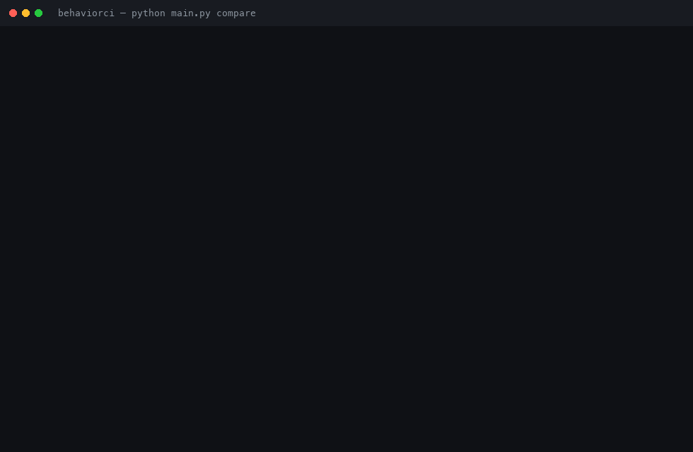
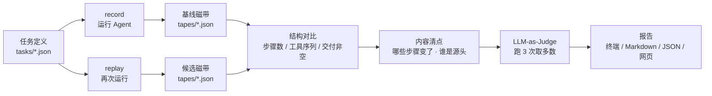

# BehaviorCI

**给 Agent 装上行为回归 CI：Prompt 是代码，Agent 的行为就该有 CI。**

[](https://github.com/tudou718/behaviorci/actions/workflows/behaviorci.yml)
[](https://tudou718.github.io/behaviorci/)

**第一次用？从 [接入指南](docs/integration.md) 开始（[网页版，手机也能看](https://tudou718.github.io/behaviorci/guide.html)）。**



## 痛点：改一行 Prompt，Agent 就悄悄变了

Agent 的输出是不确定的。改一句提示词、换一个模型版本、调一下温度——
最终答案可能看起来还像样，但**中间过程已经变了**：少调了一次工具、跳过了检索、
把两个事实拼错了。

传统测试断言「输出等于某个字符串」，在 Agent 上根本用不了：同一个问题，
两次回答的措辞必然不同。于是大家只能靠人肉点一遍——直到某天线上出问题。

**问题不在「结果对不对」，而在「行为有没有漂移」。**

## 它怎么解决：录 → 放 → 比 → 判

1. **录**：Agent 每做一步（调工具、拿结果、说话）都记一笔，存成一份行为磁带
2. **放**：改了 Prompt 或模型之后，用同一个任务再跑一遍，得到第二份磁带
3. **比**：先做结构对比（步骤数、工具序列、有没有交付），再做字段级差异清点
4. **判**：把两份磁带交给 LLM 裁判，它给出三选一结论——**等价 / 变好 / 漂移**，并说明理由
5. **出报告**：终端结论 + Markdown/JSON 报告 + 一页公开网页

裁判不是判一次就完：同一个对比会跑 **3 次取多数**，票型（比如 3:0 或 2:1）一并写进报告——
分歧本身就是「这题该由人来拍板」的信号。

## 快速上手

```bash
pip install -r requirements.txt
cp .env.example .env          # 填入 LLM_BASE_URL / LLM_API_KEY / LLM_MODEL

# 1. 录一份基线磁带
python main.py record --label baseline

# 2. 改完 Prompt 后，用同一任务再跑两次
python main.py replay --runs 2 --labels baseline,new-prompt

# 3. 对比 + 裁判 + 报告，并在浏览器打开可视化报告
python main.py compare tapes/<基线>.json tapes/<候选>.json --open
```

报告会同时生成 `reports/xxx.html`（网页，给人看）、`.md` 和 `.json`（给 CI 用）。
不加 `--open` 也可以手动打开 `reports/` 里的 html 文件。

`compare` 默认裁判跑 3 次；想省钱用 `--judge-runs 1`，只查结构用 `--no-judge`，
判定漂移时让命令以非零退出码失败（给 CI 用）加 `--fail-on-drift`。

## 架构



三个设计决定，决定了它好不好用：

| 决定 | 为什么 |
|---|---|
| 磁带记「每步的输入输出」，不只记最终答案 | 只看答案分不清「等价重写」和「行为退化」 |
| 结构对比与语义裁决分开 | 骨架塌了不用花钱问模型；骨架没事才需要读内容 |
| 裁判多次投票、保留分歧 | 单次裁决等于抽签，票型才是可信度 |

## 案例数据

以下都是真实运行，不是编的。

**示例 Agent（daily-brief：关键词 → 模拟搜索 → 200 字摘要）**

- 6 份基线磁带 + 2 份漂移案例磁带，2 个任务，24 步记录
- 每次对比含 3 项结构检查、内容清点，以及裁判 3 次投票
- 未改动代码的重复运行：裁判 3:0 判「等价」——措辞抖动没有被误报成漂移

**真实漂移案例（两次改 Prompt，结果不同）**

| 改动 | 裁判结论 | 说明 |
|---|---|---|
| 允许「多用形容词、补充合理的行业数字」 | 等价 3:0 | 模型仍然按资料写，行为没变——**改了 Prompt 不等于改了行为** |
| 要求「无视资料、凭印象自由发挥」 | **漂移 3:0** | 关键结论偏移，裁判指出具体依据 |

这说明裁判看的是**行为**，不是 diff 本身：它不会因为「文字不一样」就报警，
也不会因为「文件被改过」就默认出事。

**真实的裁判分歧（2026-11-03 自动巡检）**

同一次对比，3 次判决是 **等价 / 漂移 / 等价**，最终按多数判「等价（2:1）」：

> 第 2 次判「漂移」的理由：末句把最未解决问题从「行为可复现性」改为「缺评测标准」，关键结论偏移。

单次裁决会让人虚惊一场；票型告诉你有 2/3 的判断认为没问题。**这正是分布校验存在的意义。**

**开销**：一次完整巡检（录 1 次 + 裁判 3 次）约 4.8k token。
用 `python main.py stats` 可以随时看对比次数、判定分布和 token 用量
（计量从 v0.1 起启用，更早的运行未记录）。

**真实项目：智研搜**

[智研搜](https://github.com/tudou718/deepsearch-agents-learning) 是基于
LangGraph/deepagents 的多智能体研搜平台。接入只做了三件事：在主智能体流式循环里记录
每条消息、对易变的会话 id 脱敏、用一个脚本跑两轮生成磁带。结果：

```
步骤数   ✓ 一致（3 = 3）
工具序列 ✓ 一致（tool:generate_markdown → tool_result → model_message）
最终交付 ✓ 一致（99 字 / 99 字）
裁判：等价 3:0
```

接入过程还倒逼出两个通用性修复：不同 Agent 的交付物字段名不同（`summary` vs `final`）、
每次运行必变的 session id 会污染对比。**拿真实项目吃狗粮，才会暴露假数据永远发现不了的问题。**

## 自动巡检与公开报告

[`.github/workflows/behaviorci.yml`](.github/workflows/behaviorci.yml) 会在手动触发、
或任务定义 / 源码 / 基线磁带变更时自动运行：录一份候选磁带 → 与仓库里最新的基线对比 →
报告写进运行摘要和产物，同时发布到 [GitHub Pages](https://tudou718.github.io/behaviorci/)。

三个模型配置放在仓库 Secrets 里（`LLM_BASE_URL` / `LLM_API_KEY` / `LLM_MODEL`），
`.env` 不进 Git。

## 项目结构

```
behaviorci/
├── main.py                 # 统一入口：record / replay / compare
├── src/
│   ├── demo_agent.py       # 被测试的 Agent（主题 → 关键词 → 搜索 → 摘要）
│   ├── recorder.py         # 行为磁带记录器
│   ├── replay.py           # 重放与并排查看
│   ├── diff.py             # 结构对比 + 内容清点
│   ├── judge.py            # LLM-as-Judge 与多次投票
│   ├── report.py           # Markdown / JSON 报告
│   ├── pages.py            # 静态网页渲染
│   ├── llm.py              # 模型调用（配置、JSON 解析）
│   └── tape.py             # 磁带的读与字段级比较
├── tasks/                  # 任务定义
├── tapes/                  # 行为磁带（基线，进 Git）
├── reports/                # 生成的报告（不进 Git）
└── docs/demo.gif           # 演示动图（由真实输出渲染）
```

## 离开演示 Agent 也能用

BehaviorCI 不绑定任何框架：只要能按「步骤 + 输入 + 输出」记录一次运行，
就能生成磁带。智研搜的接入层（`app/observability/behaviorci.py`）只有百来行，
复用了同一套 Recorder 和磁带格式。

接入自己的项目：复制一份 `src/recorder.py`，在 Agent 的主循环里每完成一步调一次
`recorder.log(name, input, output)`，最后 `finish()`。剩下的对比、裁判、报告都现成。

**完整的分步说明（含最小示例、脱敏写法、常见问题）见
[接入指南](docs/integration.md)。**

## 局限

- 示例 Agent 的搜索步骤是固定假数据（真实接入见智研搜案例）
- 裁判结论依赖模型能力；对模棱两可的改动，票型会分裂，此时应以人工判断为准
- 磁带记录工具层面的输入输出，不记录模型内部的推理过程

## 文档

- [接入指南](docs/integration.md) — 把 BehaviorCI 接到自己的 Agent 上：三步接入、最小示例、脱敏写法、常见问题（[网页版](https://tudou718.github.io/behaviorci/guide.html)）
- [巡检工作流](.github/workflows/behaviorci.yml) — 自动录制、对比、发布报告

## License

MIT
